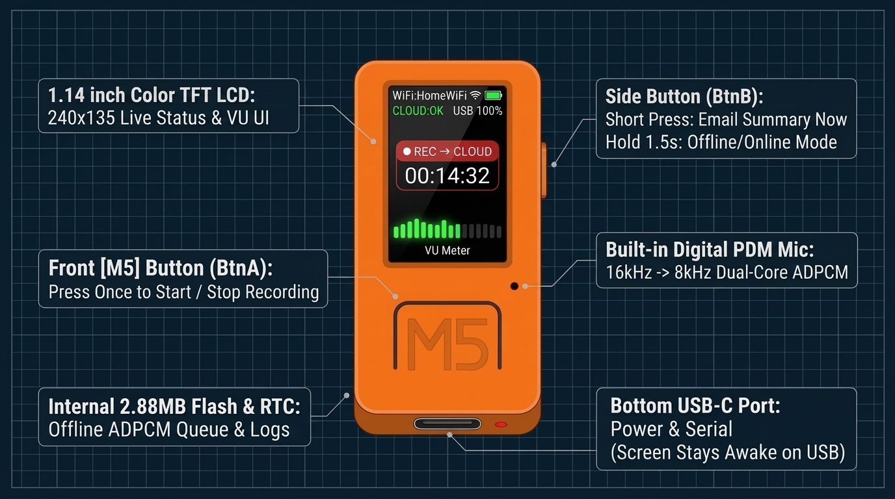
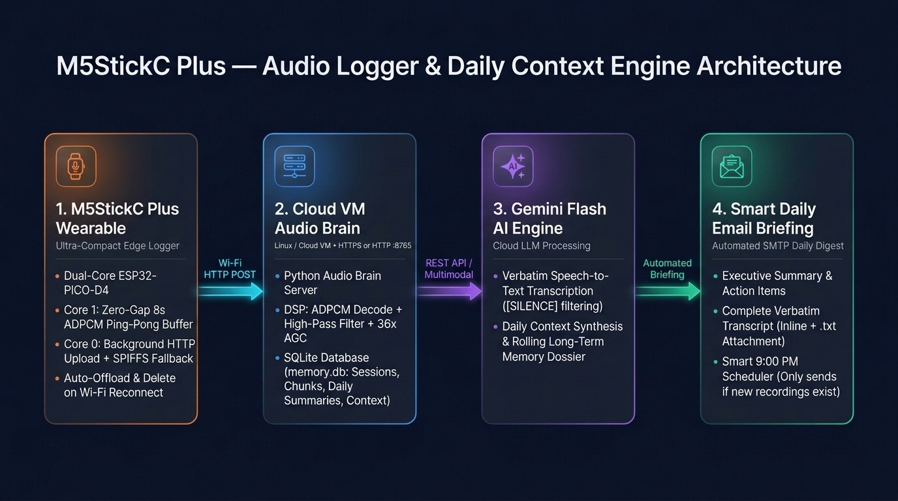
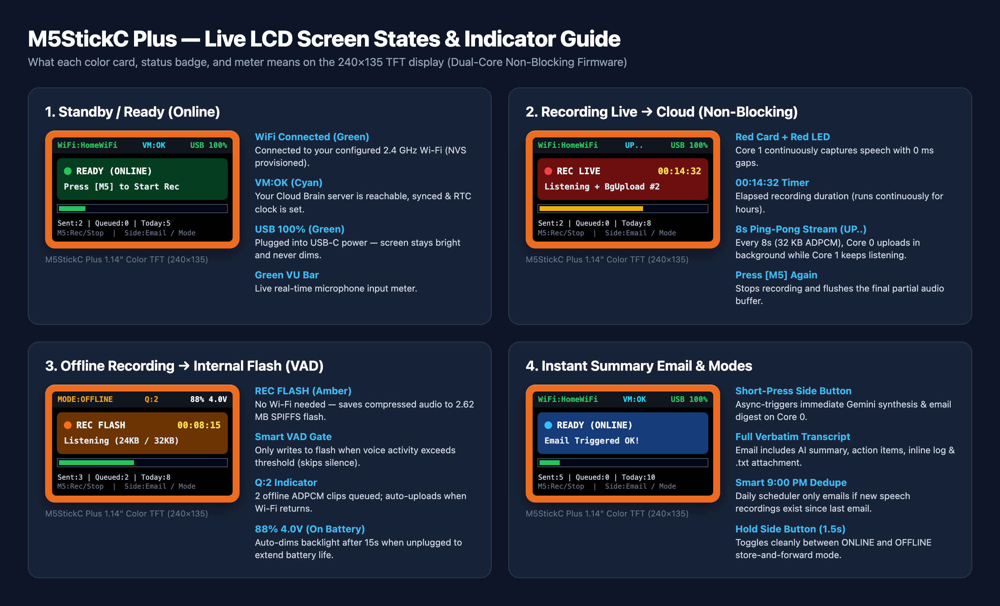

# M5StickC Plus Audio Logger & Context Brain

A dual-core, non-blocking wearable voice & context logger built on the **M5StickC Plus (ESP32-PICO-D4)** paired with a self-hosted **Python Cloud Brain** powered by **Gemini Flash**, **SQLite** rolling long-term memory, and daily **HTML email briefings**.

Designed with **zero hardcoded secrets**: all Wi-Fi credentials, Cloud server endpoints, and authentication tokens live in ESP32 **NVS flash** (provisioned via captive SoftAP portal or USB serial) and server `.env` files.

---

## Visual Overview

| Device Controls & Layout | Dual-Core System Architecture | LCD Screen States |
| :---: | :---: | :---: |
|  |  |  |

---

## Key Features

### Embedded ESP32 Firmware (`firmware/src/main.cpp`)
* **True Dual-Core Non-Blocking Streaming**: Core 1 continuously captures PDM microphone audio at `16 kHz` into dual `8 s` IMA-ADPCM (`128 KB` -> `~58 KB` WAV) ping-pong RAM buffers, while Core 0 handles HTTP uploads and SPIFFS flushing asynchronously—**zero audio gaps between chunks**.
* **Seamless Offline Mode & Failover**: If Wi-Fi drops, Cloud reachability fails, or **Offline Mode** is toggled (Side Button `BtnB` long press `> 1.5 s`), chunks seamlessly spill over to `2.8 MB` of internal **SPIFFS flash** (~48+ chunks) using energy-based **Voice Activity Detection (VAD)** to skip silence.
* **Automatic Backfill Drain**: As soon as Wi-Fi and Cloud connectivity recover, Core 0 drains queued SPIFFS chunks to the server in chronological order before returning to sleep.
* **Watch Face Mode & Brightness Studio**: Switch cleanly between **Audio Logger**, customizable **Watch Face** (4 styles: Digital Bold, Minimal Stealth, Analog+Digital, Retro 7-Seg; 6 accent colors; 12h/24h; 180° flip; optional pocket record-lock; custom label), and **Screen Off (Stealth)** via the physical Power button or Web Portal—plus a `10–100%` backlight brightness slider persisted in ESP32 NVS.
* **Zero Hardcoded Credentials (NVS Provisioned)**: Boots safely into a local `M5-AudioLogger` SoftAP configuration portal (`http://192.168.4.1`) when unprovisioned, or accepts USB serial configuration (`WIFI:...`, `CLOUD:...`) via `configure_wifi.py`.
* **Live On-Device Studio & Logs**: Serves live display/watch face controls, telemetry, and recent device logs directly over LAN (`http://<device-ip>/`) with HTML escaping and non-echoing secret inputs.

### Self-Hosted Cloud Brain (`cloud/server.py`)
* **DSP Audio Normalization + Gemini Transcription**: Applies DC offset removal, ~80 Hz high-pass filtering, and peak/RMS automatic gain control (AGC) in pure Python before transcribing speech with Gemini Flash (with automatic model fallback and `[SILENCE]` filtering).
* **SQLite Context & Long-Term Memory**: Persists individual transcript chunks, recording sessions, daily markdown summaries, and an evolving cumulative **Long-Term Memory** profile.
* **Mobile-Responsive Web Portal (`docs/index.html`)**: Live dashboard showing device telemetry (`Wi-Fi`, battery voltage, active recording state, queue depth), searchable transcripts, rolling memory editor, server & device log viewers, interactive visual guides, and an on-demand summary/email trigger.
* **Security Hardened**:
  * Timing-safe (`hmac.compare_digest`) fail-closed `X-Device-Token` authentication for all device uploads and device log writes.
  * Optional HTTP Basic Auth (`DASHBOARD_USER` / `DASHBOARD_PASSWORD`) for web dashboard and API routes, plus a 60-second rate-limit cooldown on web summary generation.
  * Path-traversal protection on log endpoints, CRLF log-injection stripping, and sanitized session filenames.
* **Daily & On-Demand Email Briefings**: Generates structured HTML briefings via SMTP and includes verbatim transcript attachments.

---

## Repository Structure

```text
.
├── .env.example                 # Template environment configuration for Cloud Brain & CLI tools
├── configure_wifi.py            # USB serial utility to provision Wi-Fi & Cloud credentials + tail logs
├── sync_logs.py                 # Helper to pull database & server logs locally via HTTP / gcloud / serial
├── cloud/
│   └── server.py                # Self-hosted Python HTTP API, DSP pipeline, Gemini transcriber & Web UI
├── firmware/
│   ├── platformio.ini           # PlatformIO config (m5stick-c, espressif32 @ 6.5.0)
│   ├── partitions_logger.csv    # Custom 4 MB partition table (2.8 MB SPIFFS audio spool)
│   └── src/
│       └── main.cpp             # Dual-core FreeRTOS firmware (PDM + ADPCM + ping-pong + NVS portal)
└── docs/
    ├── ARCHITECTURE.md          # Detailed sequence diagrams, SPIFFS lifecycle & SQLite ERD
    ├── USER_GUIDE_AND_TESTING.md# Button controls, serial commands, logs & testing checklist
    ├── index.html               # Mobile-responsive Web Dashboard & Visual Control Center
    ├── manifest.json            # PWA web manifest for mobile home-screen installation
    └── images/                  # Hardware button guide, architecture diagram & LCD state guide
```

---

## Quick Start

### 1. Deploy & Configure the Cloud Brain

The Cloud Brain uses Python 3 standard library modules only—no external `pip` packages are required on the server.

1. Generate a strong device authentication token:
   ```bash
   openssl rand -hex 24
   ```
2. Copy `.env.example` to `cloud/.env` and fill in your credentials:
   ```bash
   cp .env.example cloud/.env
   chmod 600 cloud/.env
   ```
   Key variables in `cloud/.env`:
   * `GEMINI_API_KEY` — Gemini API key from Google AI Studio
   * `DEVICE_TOKEN` — The random token generated above
   * `PORT` — HTTP listener port (default `8765`)
   * `TIMEZONE` — IANA timezone for daily boundaries & summary schedules (default `UTC`)
   * `SENDER_EMAIL`, `SENDER_PASSWORD`, `RECIPIENT_EMAIL`, `SMTP_HOST`, `SMTP_PORT` — Optional SMTP config for email briefings
   * `DASHBOARD_USER`, `DASHBOARD_PASSWORD` — Optional HTTP Basic Auth for protecting the public dashboard

3. Start the server (systemd or background process):
   ```bash
   python3 cloud/server.py
   ```
   Verify health:
   ```bash
   curl -s http://localhost:8765/api/ping
   ```

> [!IMPORTANT]
> If exposing port `8765` on the public internet, set `DASHBOARD_USER` and `DASHBOARD_PASSWORD` in `cloud/.env` or place the server behind an HTTPS reverse proxy / WireGuard / Tailscale tunnel.

---

### 2. Build & Flash the Firmware

Requirements: [PlatformIO](https://platformio.org/) (or [`uv`](https://docs.astral.sh/uv/) via `uvx --from platformio pio`).

1. Connect your **M5StickC Plus** over USB-C and flash:
   ```bash
   cd firmware
   uvx --from platformio pio run -t upload
   ```

---

### 3. Provision Wi-Fi & Cloud Credentials (Zero Hardcoded Secrets)

Because no Wi-Fi password, server IP, or token is compiled into the binary, provision the device once via **either** method below (stored persistently in ESP32 NVS flash across firmware updates):

#### Option A — SoftAP Web Portal (No Computer Needed)
1. Power on the M5StickC Plus (if unprovisioned, it starts the **`M5-AudioLogger`** Wi-Fi hotspot).
2. Connect your phone or laptop to the `M5-AudioLogger` 2.4 GHz network.
3. Open `http://192.168.4.1` in your browser.
4. Enter:
   * **2.4 GHz Wi-Fi SSID & Password**
   * **Cloud Server Host & Port** (e.g. your server IP/domain and `8765`)
   * **Device Auth Token** (`DEVICE_TOKEN` from `cloud/.env`)
5. Click **Save**. The device verifies connectivity and updates the LCD to `READY`.

#### Option B — USB Serial Provisioning (`configure_wifi.py`)
With the device plugged in over USB-C:
```bash
# Provision Wi-Fi (prompts securely if password omitted)
uv run --with pyserial python3 configure_wifi.py set "Your_2.4GHz_WiFi_SSID"

# Provision Cloud server & Device Token (prompts securely if token omitted)
uv run --with pyserial python3 configure_wifi.py cloud your.server.host 8765

# Verify live status or tail serial logs
uv run --with pyserial python3 configure_wifi.py status
uv run --with pyserial python3 configure_wifi.py logs
```

---

## Hardware Controls

| Button | Action | Behavior |
| :--- | :--- | :--- |
| **Front Button (`BtnA`)** | Short Press | Toggle Recording (**Start / Stop**) *(can be pocket-locked in Watch Face mode)* |
| **Side Button (`BtnB`)** | Short Press | Trigger **On-Demand Daily Summary & Email Briefing** |
| **Side Button (`BtnB`)** | Long Press (`> 1.5 s`) | Toggle **Offline SPIFFS Mode** (airplane / power-save mode) |
| **Bottom-Left Power (`AXP192`)** | Short Tap | Cycle Screen Mode (**Audio Logger → Watch Face → Screen Off**) |
| **Bottom-Left Power (`AXP192`)** | Hold (`~1 s`) | Cycle Screen Brightness (**40% → 65% → 85% → 100%**) |
| **Bottom-Left Power (`AXP192`)** | Hold (`> 4 s`) | Hardware Power Off |

---

## Documentation

* [System Architecture & Database ERD](docs/ARCHITECTURE.md)
* [User Guide, Serial Commands & Testing Checklist](docs/USER_GUIDE_AND_TESTING.md)
* [Web Dashboard UI (`docs/index.html`)](docs/index.html)

---

## Security Practices

* **Never commit** `.env`, `cloud/.env`, SQLite `.db` files, `.log` files, audio `.wav` spools, or flash `.bin` backups (all excluded via `.gitignore`).
* Rotate `DEVICE_TOKEN` immediately if a device is lost or credentials were exposed.
* Use HTTPS (reverse proxy) or a private VPN overlay if transmitting sensitive audio outside your local network.
