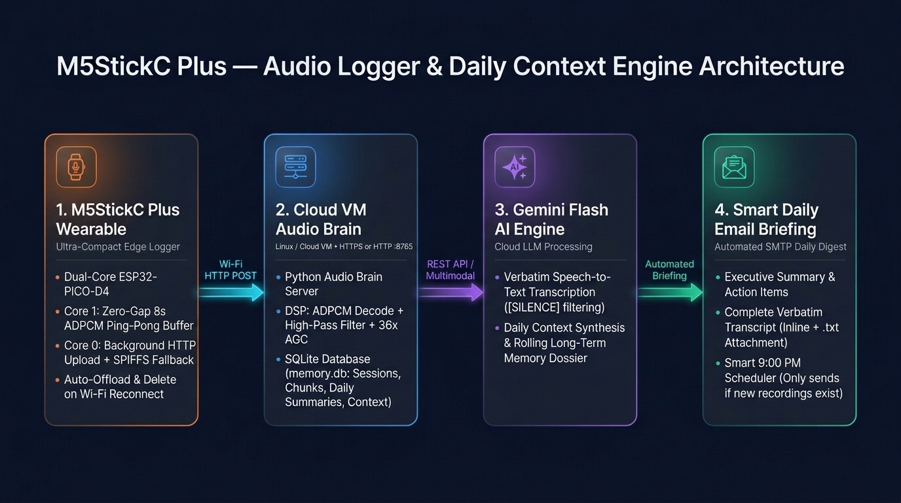
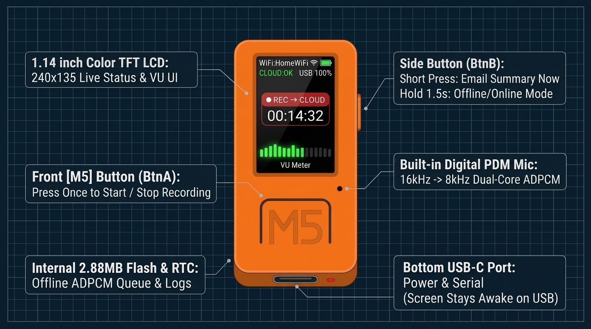
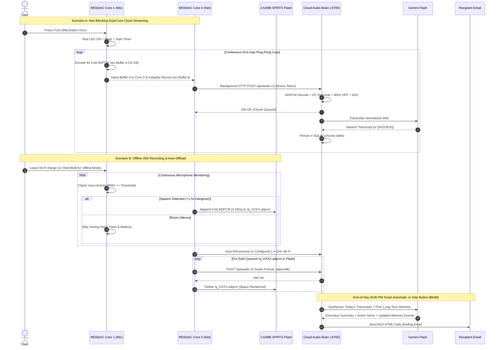
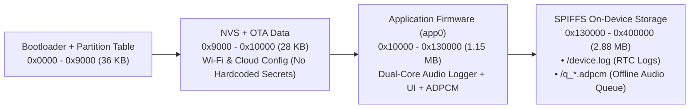
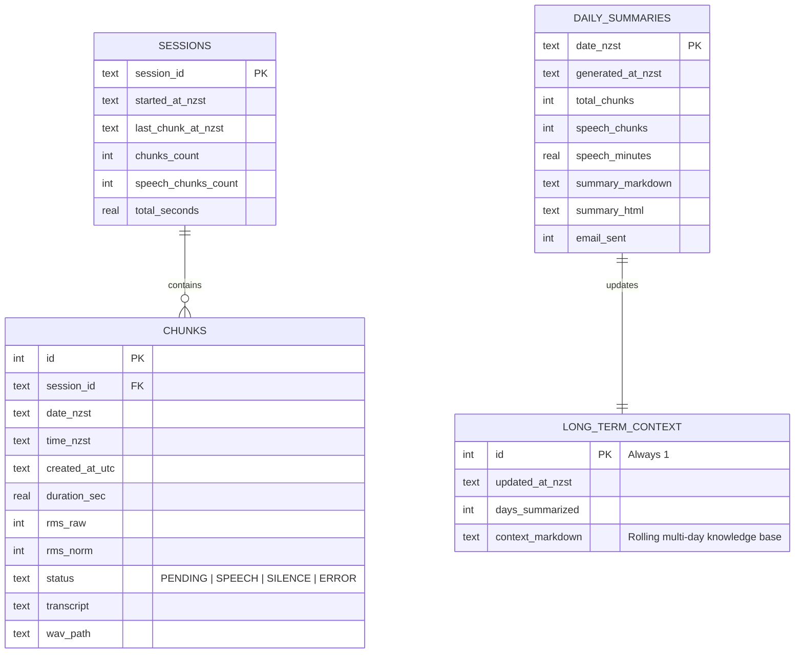

# System Architecture: M5StickC Plus Audio Logger & Daily Context Engine

## 1. Executive Overview

This system turns an **M5StickC Plus (`ESP32-PICO-D4`)** into a wearable/desk continuous audio logger with **Dual-Core Non-Blocking Ping-Pong Cloud Streaming** and **Offline Store-and-Forward Buffering**, backed by a lightweight self-hosted Linux/Cloud Python backend, **Gemini Flash** speech transcription, an evolving **SQLite Long-Term Memory Engine**, and automated daily HTML email briefings (with full verbatim transcripts).



### Hardware Overview & Controls



---

## 2. Detailed Component & Data Flow Diagram (Mermaid)

```mermaid
flowchart TB
    subgraph Device["M5StickC Plus (ESP32-PICO-D4 Dual-Core @ 240MHz)"]
        Mic["SPM1423 Digital PDM Mic<br/>(GPIO 0 CLK / GPIO 34 DATA)"]
        Core1["Core 1: Real-Time Audio Loop<br/>(16kHz->8kHz ADPCM into 2x32KB Static Ping-Pong)"]
        Core0["Core 0: Async Network Worker<br/>(HTTP Stream + Auto-Reconnect + Offload)"]
        Btn["Buttons: Front [M5] & Side [BtnB]"]
        RTC["BM8563 Hardware RTC<br/>(Synced via Cloud Ping)"]
        PMIC["AXP192 Power Manager<br/>(Battery Telemetry + Auto-Dim)"]
        LCD["1.14-inch IPS TFT LCD<br/>(240x135 Live VU & Timer)"]
        SPIFFS["2.62 MB Internal SPIFFS Flash<br/>(/q_*.adpcm Queue + /device.log)"]

        Mic -->|16kHz 16-bit DMA| Core1
        Core1 -->|Zero-Gap 8s Buffer Swap| Core0
        Btn --> LCD
        RTC --> SPIFFS
        PMIC --> LCD
    end

    subgraph Network["Connectivity Modes"]
        Online["Online Mode (Configured 2.4GHz Wi-Fi)<br/>8s Non-Blocking Ping-Pong Stream"]
        Offline["Offline Mode (No Wi-Fi)<br/>VAD-Gated 4-bit ADPCM in Flash"]
        Offload["Auto Store-and-Forward Offloader<br/>(Uploads & Deletes on Reconnect)"]
    end

    subgraph CloudVM["Self-Hosted Cloud Audio Brain (:8765)"]
        API["Python ThreadingHTTPServer<br/>(/api/audio, /api/summarize, /api/logs)"]
        DSP["Audio DSP Pipeline<br/>(ADPCM Decode + DC Removal + 80Hz HPF + AGC)"]
        Queue["Background Transcription Worker"]
        DB[("SQLite Database (memory.db)<br/>• sessions<br/>• chunks<br/>• daily_summaries<br/>• long_term_context")]
        Logs["Persistent Server Logs<br/>(audio_brain.log + m5stick_device.log)"]
        Sched["9:00 PM Smart Daily Scheduler"]
        Dash["Live Responsive Web Portal<br/>(http://YOUR_SERVER_IP:8765/)"]
    end

    subgraph ExternalServices["Google AI & Email Services"]
        Gemini["Gemini 3.5 Flash / Flash-Lite<br/>(Speech-to-Text + Context Synthesis)"]
        Gmail["SMTP Email (e.g. smtp.gmail.com:587)<br/>Daily Briefing -> Configured Recipient"]
    end

    Core0 -->|Wi-Fi Connected| Online
    Core0 -->|No Wi-Fi / Upload Spill| Offline
    Offline -->|Writes Active Speech Only| SPIFFS
    SPIFFS -->|Wi-Fi Reconnected| Offload

    Online -->|HTTP POST /api/audio (adpcm8k)| API
    Offload -->|HTTP POST /api/audio (adpcm8k)| API

    API --> DSP
    API --> Logs
    DSP --> Queue
    Queue -->|WAV Audio Inline Data| Gemini
    Gemini -->|Verbatim Transcript / SILENCE| DB
    Sched -->|Reads Today + Rolling Memory| Gemini
    Gemini -->|Updated Long-Term Memory + Daily Summary| DB
    Sched -->|HTML Briefing| Gmail
    DB --> Dash
```

---

## 3. Dual-Core Recording Sequence Diagram (Online Streaming vs. Offline Store-and-Forward)



---

## 4. M5StickC Plus 4 MB Flash Partition Layout

By replacing the default dual-OTA partition layout with [`firmware/partitions_logger.csv`](../firmware/partitions_logger.csv), usable on-device file storage was doubled to **~2.8 MB SPIFFS**:



| Partition | Start Offset | Size | Purpose |
| :--- | :--- | :--- | :--- |
| `nvs` | `0x009000` | `20 KB` | Encrypted/Persistent NVS Wi-Fi & Cloud Host/Token storage |
| `otadata` | `0x00E000` | `8 KB` | Bootloader partition selector |
| `app0` | `0x010000` | `1,152 KB` | Compiled M5StickC Plus firmware |
| `spiffs` | `0x130000` | **`2,880 KB`** | On-device logs (`/device.log`) + Offline ADPCM speech queue (`/q_*.adpcm`) |

---

## 5. SQLite Database Schema (`memory.db` on Cloud VM)



---

## 6. Hardware Pinout & Peripherals Used on M5StickC Plus

| Peripheral | Chip / Sensor | ESP32 GPIO / Bus | Role in Audio Logger |
| :--- | :--- | :--- | :--- |
| **Digital Microphone** | SPM1423 PDM MEMS | `GPIO 0` (CLK), `GPIO 34` (DATA) | 16 kHz 16-bit DMA audio capture |
| **Color Display** | 1.14" ST7789v2 TFT | SPI (`240x135` Landscape) | Live recording timer, VU meter, Wi-Fi/VM status |
| **Front Button (`BtnA`)** | Tactile Pushbutton | `GPIO 37` | One-press Start / Stop Recording |
| **Side Button (`BtnB`)** | Tactile Pushbutton | `GPIO 39` | Short press: Send Summary Email; Hold 1.5s: Toggle Offline/Online Mode |
| **Red Indicator LED** | Internal SMD LED | `GPIO 10` (Active-LOW) | Lit continuously while recording is active |
| **Passive Buzzer** | Piezo Speaker | `GPIO 2` | Audible start/stop/email confirmation tones |
| **Real-Time Clock** | BM8563 RTC | I2C (`GPIO 21` SDA, `GPIO 22` SCL) | Hardware clock auto-synced to NZT for offline timestamps |
| **Power Management** | AXP192 PMIC | I2C (`GPIO 21` SDA, `GPIO 22` SCL) | Battery voltage/percentage telemetry & auto-dim backlight |
