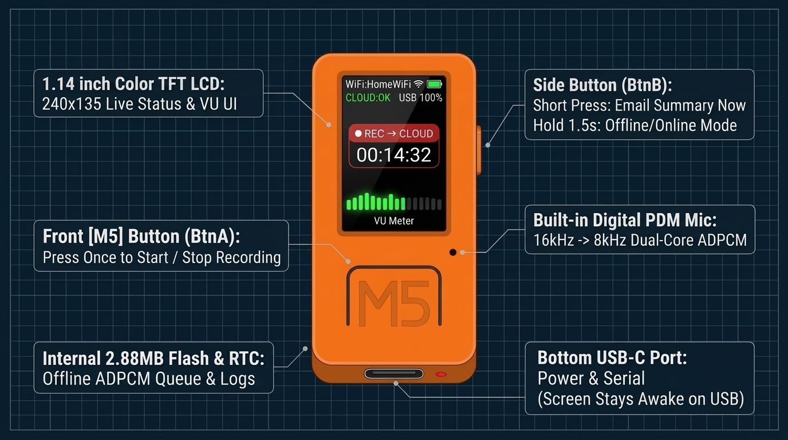
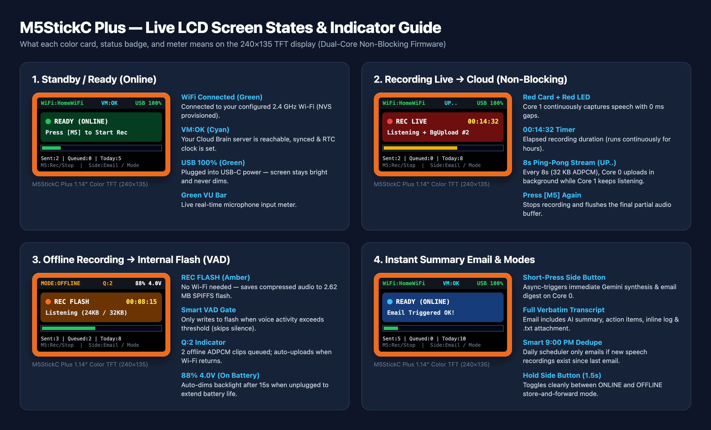
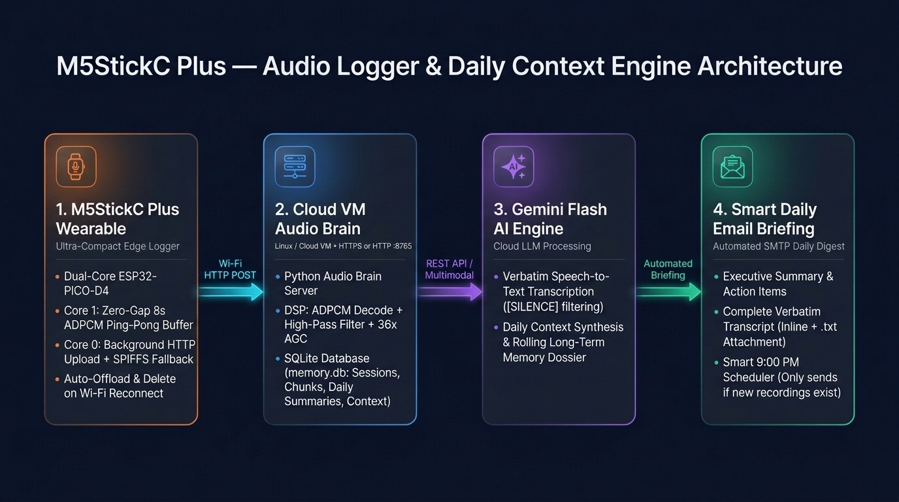

# User Guide, Logging & Testing Manual

## 1. Visual Hardware & Button Guide



| Action | Button / Input | What Happens |
| :--- | :--- | :--- |
| **Start Recording** | Press **Front `[M5]` Button** once | Plays rising double-beep, turns on Red LED, starts `HH:MM:SS` timer, and streams 8s ping-pong ADPCM segments to your Cloud server via Core 0 while Core 1 listens continuously (or buffers to flash if offline). |
| **Stop Recording** | Press **Front `[M5]` Button** again | Plays falling double-beep, turns off Red LED, flushes the final audio buffer, and returns to `READY`. |
| **Email Daily Summary Now** | Short-press **Side Button (`BtnB`)** | Queues async Gemini synthesis + emails your configured recipient with both the **full verbatim transcript inline** and an attached `transcript_YYYY-MM-DD.txt` file. |
| **Smart 9:00 PM Auto-Email** | Automatic (`21:00` local TZ) | Sends at 9:00 PM **only if** there are speech recordings today **and** new recordings have arrived since any manual email you sent earlier that day (never sends empty or duplicate emails). |
| **Toggle Offline / Online Mode** | Hold **Side Button (`BtnB`)** for 1.5s | Switches between `ONLINE` (live Wi-Fi upload) and `OFFLINE` (on-device VAD + 4-bit ADPCM flash buffering). Switching back to `ONLINE` automatically offloads & deletes queued files. |
| **Cycle Watch Face / Screen Mode** | Short-tap **Bottom-Left Power Button** | Cycles Screen Mode between **Audio Logger**, customizable **Watch Face**, and **Screen Off (Stealth)** (saved to NVS flash). |
| **Cycle Screen Brightness** | Hold **Bottom-Left Power Button (~1 s)** | Cycles awake brightness (`40% -> 65% -> 85% -> 100%`) and saves to NVS flash (or use the `10–100%` slider on the Web Portal). Hold `> 4 s` to power off hardware. |
| **Smart Power & Screen Dimming** | Automatic via AXP192 VBUS | When **plugged into USB-C power (`USB 100%`)**, the screen stays at your configured brightness. When running **unplugged on internal battery** with Auto-Dim enabled, the screen dims after 15 seconds to save battery (and wakes on any button press). |

---

## 2. Live LCD Screen States & Indicator Guide



### Screen Status Bar & Metrics Reference
* **Top-Left (`WiFi:<SSID>` / `MODE:OFFLINE`)**: Shows active 2.4 GHz Wi-Fi network in green, or amber `MODE:OFFLINE` when recording to internal flash without Wi-Fi.
* **Top-Center (`VM:OK` / `UP..` / `Q:N`)**: Shows `VM:OK` when your Cloud server is reachable, `UP..` while Core 0 uploads an 8s chunk in the background, or `Q:N` showing how many offline ADPCM clips are queued in flash.
* **Top-Right (`USB 100%` / `88% 4.0V`)**: Shows green `USB 100%` when plugged into USB-C power (screen stays at full brightness), or battery percentage + voltage when unplugged (auto-dims after 15s).
* **Bottom Counter (`Sent:X | Queued:Y | Today:Z`)**:
  * `Sent`: Clips uploaded since the device booted.
  * `Queued`: Offline speech clips currently stored in internal SPIFFS flash (`/q_*.adpcm`).
  * `Today`: Total clips stored in the Cloud SQLite database for today.

---

## 3. End-to-End Architecture Overview



---

## 4. Where All Logs & Records Are Stored

1. **On the M5StickC Plus Internal Flash (`/device.log`)**:
   * Persists across reboots and works when completely unplugged from your computer.
   * Stamped with real local date/time (from the onboard BM8563 hardware RTC synced via `/api/ping`) and battery voltage (`[2026-11-13 17:45:00 | 3.92V] ...`).
   * **View over Wi-Fi**: Open `http://<DEVICE_LAN_IP>/logs` in any browser on the same home Wi-Fi (or use the auto-detected link in the Web Portal).
   * **View over USB Serial**:
     ```bash
     uv run --with pyserial python3 configure_wifi.py logs
     ```

2. **On Your Cloud Server (`http://<YOUR_SERVER_IP>:8765`)**:
   * **Live Web Dashboard**: `/`
   * **Live Server & Mirrored Device Logs JSON**: `/api/logs`
   * **Live Database Status JSON**: `/api/status`
   * **Files on Server** (`cloud/` working directory):
     * `memory.db` (SQLite database)
     * `audio_brain.log` (Server log)
     * `m5stick_device.log` (Mirrored on-device log)
     * `recent_audio/` (Last 10 normalized `.wav` files)

3. **Local Sync (`./logs/` — Git-Ignored)**:
   * Configure `.env` (see `.env.example`) and run anytime to pull a local backup:
     ```bash
     python3 sync_logs.py vm
     ```

---

## 5. USB Serial Commands (`configure_wifi.py` or Serial Monitor at 115200 baud)

When plugged into your computer via USB-C, the M5StickC Plus accepts these commands over Serial:
* `STATUS` — Prints Wi-Fi state, SSID, IP, Cloud host/token readiness, offline queue count, free heap, and free SPIFFS KB.
* `LOGS` — Dumps the entire on-device `/device.log` from internal flash.
* `CLEARLOGS` — Clears `/device.log` on internal flash.
* `REC` / `STOP` — Starts or stops recording remotely.
* `OFFLINE` / `ONLINE` — Switches between Offline Flash Buffering mode and Online Wi-Fi Streaming mode.
* `OFFLOAD` — Forces immediate upload & deletion of any queued `/q_*.adpcm` offline clips.
* `SUMMARY` — Triggers an immediate Gemini summary & email to your configured recipient.
* `SCAN` — Scans nearby 2.4 GHz Wi-Fi networks.
* `BRIGHT:<10..100>` — Sets screen brightness percent and persists to NVS flash.
* `MODE:<0|1|2>` — Switches screen mode (`0` = Audio Logger, `1` = Watch Face, `2` = Screen Off) and persists to NVS flash.
* `WIFI:<ssid>:<password>` — Saves new Wi-Fi credentials to NVS flash and connects.
* `CLOUD:<host>:<port>:<token>` — Saves Cloud Server host, port, and `X-Device-Token` to NVS flash and tests `/api/ping`.
